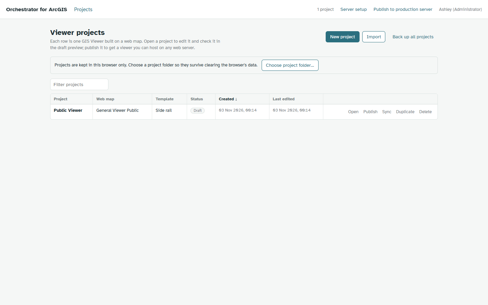
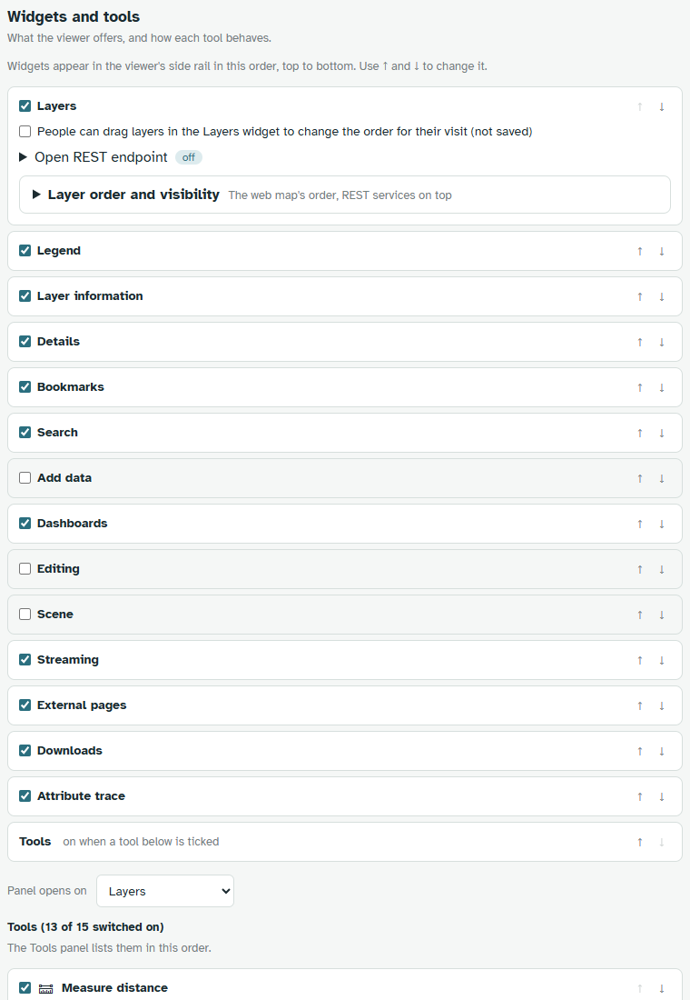
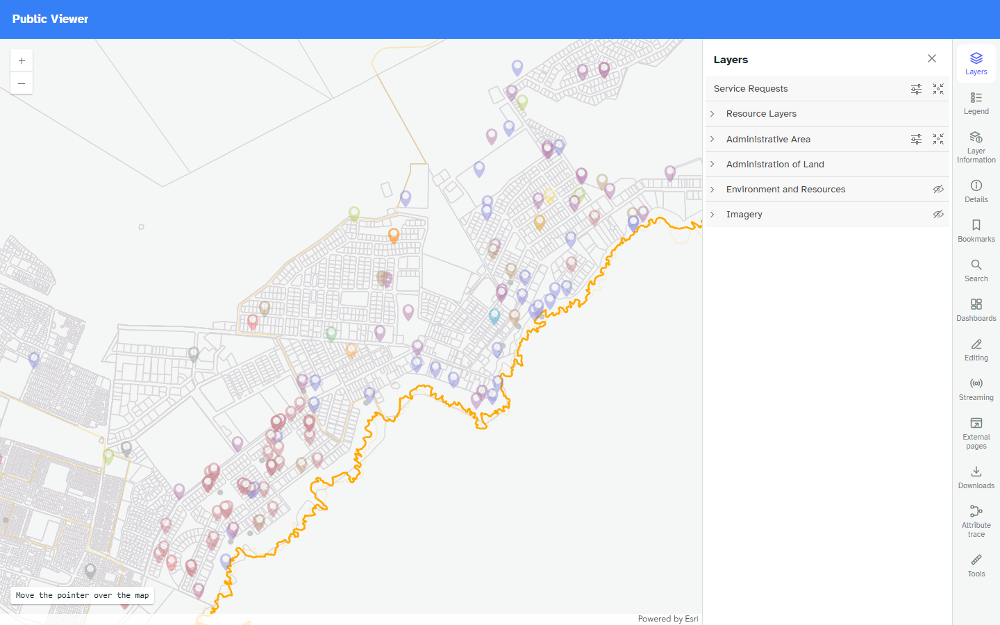
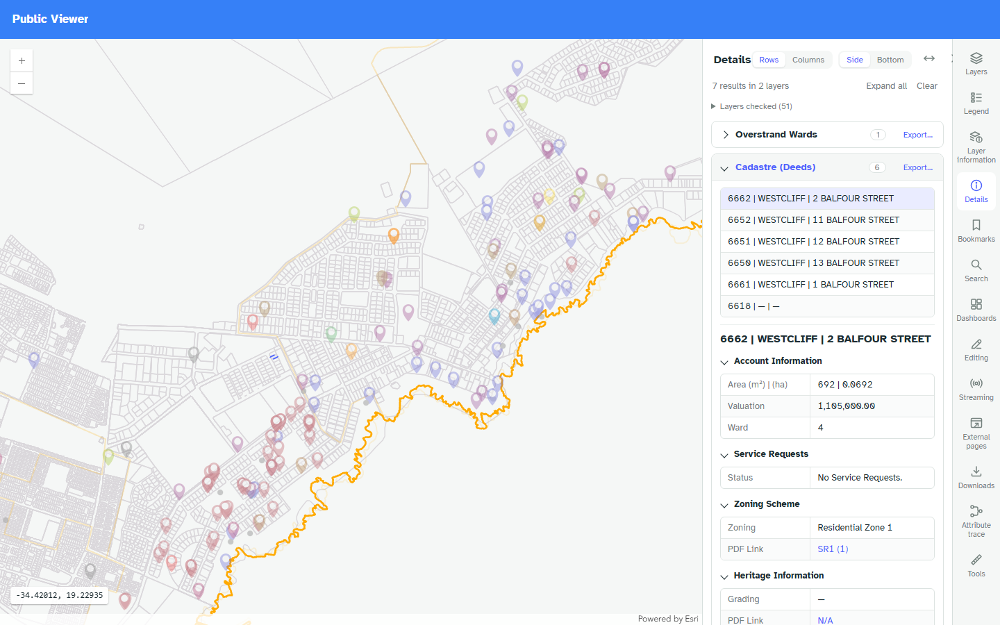
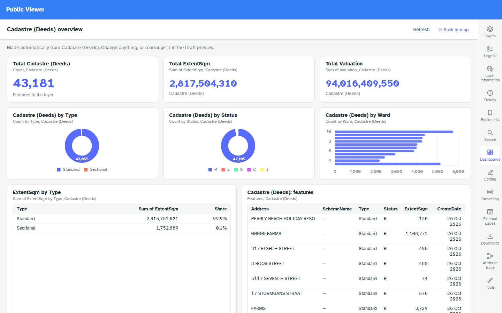
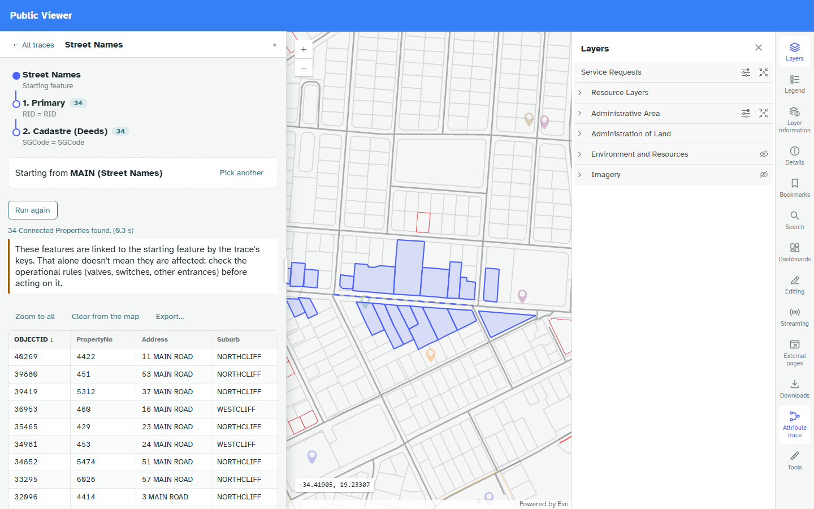

# Orchestrator for ArcGIS

Configure ArcGIS map viewers without code.

The Orchestrator is a browser app that turns an ArcGIS web map into a configured map viewer — widgets,
tools, Details panels, dashboards, editing, 3D — and publishes it as a self-contained static site. No
build step, no bundler, no backend: a published viewer is plain HTML, CSS and ES modules that any web
server can host.

**[Open the demo viewer](viewer/)** · **[Read the user guide](docs/user-guide.htm)**

The demo is a real published viewer on a public ArcGIS Online web map, so it needs no sign-in.
Everything it shows comes from one `manifest.json` beside the page.

## What it does

- Reads a web map's layers and builds a viewer from them: Layers, Legend, Layer information, Search,
  Bookmarks, Details, Dashboards, Add data, Editing, 3D scene, Streaming video, External pages,
  Downloads, Attribute trace.
- Details panels that follow a click through related records and other services, with results tables
  that export to Excel (.xlsx) and CSV.
- Tools: measure distance and area, select, draw, swipe, elevation profile, label orientation,
  dimensions, vegetation health, go to coordinates, address audit, basemap gallery, print, share link,
  screenshot, pointer coordinates.
- Draft preview runs the same runtime as the published viewer, so what you preview is what ships.
- Publishes to IIS, a Node.js Windows service or a Windows container, each with its own install script
  and an install page for the server.

## A look at it

| | |
|---|---|
|  | **Projects.** Each viewer is a project: its web map, its settings and its published versions. |
|  | **Settings, not code.** Switch widgets and tools on, set their options, preview, publish. |
|  | **The published viewer.** A side rail, a header bar or a floating panel — the same runtime either way. |
|  | **Details.** One click gathers the feature, its related records and anything else you point at. |
|  | **Dashboards.** Indicators, charts and tables counted live from the map's own layers. |
|  | **Attribute trace.** Follow a network from feature to feature, with the results listed and drawn. |

## Requirements

A published viewer needs only a web server that serves static files, and a current browser. The 3D
scene needs WebGL (a graphics card the browser can use). Services the viewer reads must allow requests
from the address it is hosted at (CORS).

## Third-party code

- [ArcGIS Maps SDK for JavaScript](https://developers.arcgis.com/javascript/latest/) 4.30, loaded from
  Esri's CDN, under Esri's terms.
- [Chart.js](https://www.chartjs.org/) 4 — MIT — dashboard charts.
- [hls.js](https://github.com/video-dev/hls.js) 1.5 — Apache-2.0 — camera and drone video.

Nothing else: no framework, no package manager, no build tooling.

## About this site

This site publishes the user guide and a demo viewer. The Orchestrator's own source is not published.
The demo's viewer runtime is here because a static viewer is served as readable source by nature —
there is no bundler or minifier in the project.

© Ashley Gahl. All rights reserved. Published as a demo and documentation, not an open-source release.

Site built 2026-11-08.
